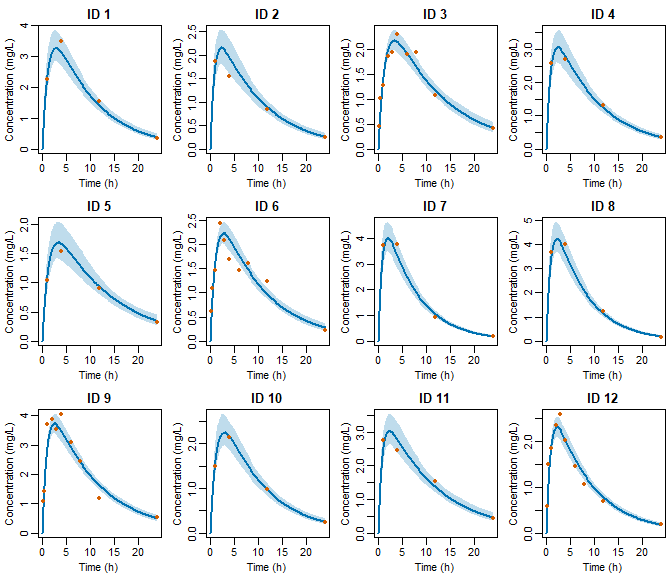
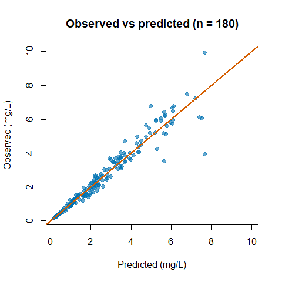
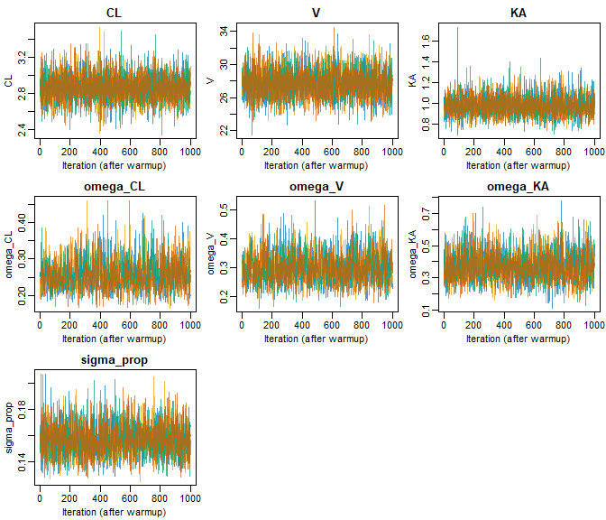
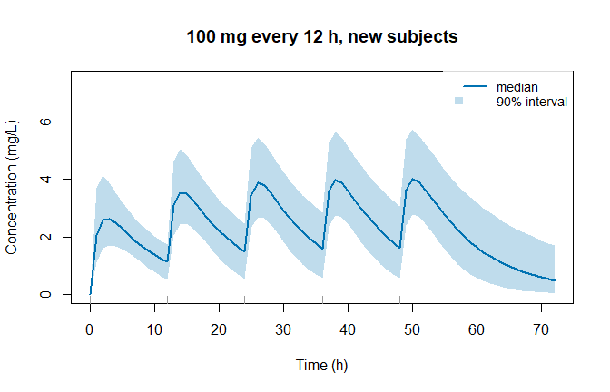

# Getting started with bayespk

bayespk fits Bayesian population pharmacokinetic (PK) models without
writing Stan. There are three steps: describe the model with
[`pk_model()`](https://daikikumakura.github.io/bayespk/reference/pk_model.md),
fit it with
[`bpk_fit()`](https://daikikumakura.github.io/bayespk/reference/bpk_fit.md),
and look at the results with
[`summary()`](https://rdrr.io/r/base/summary.html),
[`plot()`](https://rdrr.io/r/graphics/plot.default.html) and
[`predict()`](https://rdrr.io/r/stats/predict.html).

This vignette uses `bpk_example`, a simulated study that comes with the
package: 30 subjects with a single oral dose of 100 or 200 mg, with rich
sampling for every third subject and sparse sampling for the others.

``` r

library(bayespk)
head(bpk_example, 6)
#>   ID TIME AMT    DV EVID   WT SEX
#> 1  1    0 100    NA    1 69.0   1
#> 2  1    1   0 2.240    0 69.0   1
#> 3  1    4   0 3.470    0 69.0   1
#> 4  1   12   0 1.550    0 69.0   1
#> 5  1   24   0 0.356    0 69.0   1
#> 6  2    0 100    NA    1 91.9   0
```

The data are in NONMEM format: one row per dose (`EVID = 1`, `AMT`) or
observation (`EVID = 0`, `DV`). Other columns such as `WT` are
covariates. `RATE`, `MDV`, `ADDL` and `II` are read if present, and
`"."` counts as missing.

## 1. Describe the model

``` r

mod <- pk_model("1cmt", route = "oral", iiv = c("CL", "V", "KA"), error = "proportional")
mod
#> bayespk model: 1cmt oral 
#>   parameters: CL, V, KA 
#>   between-subject variability (log-normal): CL, V, KA  
#>   residual error: proportional
```

`iiv` lists the parameters with log-normal between-subject variability.
Structures are `"1cmt"` and `"2cmt"`; routes are `"iv"` (bolus, or
infusion from `RATE`) and `"oral"`.

## 2. Fit

``` r

fit <- bpk_fit(mod, bpk_example, chains = 4, cores = 4, seed = 1)
fit
#> bayespk model: 1cmt oral 
#>   parameters: CL, V, KA 
#>   between-subject variability (log-normal): CL, V, KA  
#>   residual error: proportional 
#>   data: 30 subjects, 180 observations, 30 doses
#>   sampling: 4 chains, 33.9 s
#>    variable   mean     sd     q5    q50    q95 rhat ess_bulk ess_tail
#>          CL  2.860 0.1420  2.630  2.860  3.100 1.00     6530     2740
#>           V 27.700 1.6400 25.100 27.700 30.600 1.00     4760     3040
#>          KA  0.976 0.0905  0.840  0.971  1.130 1.00     4750     2980
#>    omega_CL  0.257 0.0405  0.199  0.252  0.330 1.01      910     1500
#>     omega_V  0.298 0.0486  0.226  0.295  0.384 1.00     1050     2090
#>    omega_KA  0.365 0.0849  0.238  0.358  0.515 1.00     1490     2030
#>  sigma_prop  0.157 0.0117  0.139  0.156  0.176 1.00     2030     2860
```

Priors not given are set to weakly informative defaults; they are listed
with the fit (`fit$priors`). The model is precompiled, so nothing is
compiled here. This fit took 34 seconds with 4 chains on 4 cores.

[`bpk_fit()`](https://daikikumakura.github.io/bayespk/reference/bpk_fit.md)
warns about divergent transitions, R-hat above 1.01, low effective
sample size and chains that settled in different modes. The numbers are
also available directly:

``` r

d <- bpk_diagnostics(fit)
d[c("divergent", "rhat_max", "ess_bulk_min")]
#> $divergent
#> [1] 0
#> 
#> $rhat_max
#> [1] 1.007923
#> 
#> $ess_bulk_min
#> [1] 909.9531
```

## 3. Results

``` r

summary(fit)
#>    variable   mean     sd     q5    q50    q95 rhat ess_bulk ess_tail
#>          CL  2.860 0.1420  2.630  2.860  3.100 1.00     6530     2740
#>           V 27.700 1.6400 25.100 27.700 30.600 1.00     4760     3040
#>          KA  0.976 0.0905  0.840  0.971  1.130 1.00     4750     2980
#>    omega_CL  0.257 0.0405  0.199  0.252  0.330 1.01      910     1500
#>     omega_V  0.298 0.0486  0.226  0.295  0.384 1.00     1050     2090
#>    omega_KA  0.365 0.0849  0.238  0.358  0.515 1.00     1490     2030
#>  sigma_prop  0.157 0.0117  0.139  0.156  0.176 1.00     2030     2860
```

The data were simulated with CL = 3 L/h, V = 30 L and KA = 1.2 1/h for a
70 kg subject, with between-subject SDs of 0.3, 0.2 and 0.4 and a
proportional residual SD of 0.15. Estimates differ from these values
partly because 30 simulated subjects are a sample: in this sample, the
geometric mean of the individual KA values is 1.13, at the upper end of
the 90% interval. The model above also ignores weight, so the
between-subject SDs of CL and V also absorb the weight effect; the
[covariates
vignette](https://daikikumakura.github.io/bayespk/articles/covariates-priors.md)
adds it.

Individual fits, one panel per subject (median and 90% interval,
observations in red):

``` r

plot(fit, xlab = "Time (h)", ylab = "Concentration (mg/L)")
```



plot of chunk individual

Observed against predicted concentrations:

``` r

plot(fit, type = "obs_pred", xlab = "Predicted (mg/L)", ylab = "Observed (mg/L)")
```



plot of chunk obs-pred

Trace plots of the population parameters; overlapping chains mean they
mixed:

``` r

plot(fit, type = "trace")
```



plot of chunk trace

## 4. Predict a new regimen

[`predict()`](https://rdrr.io/r/stats/predict.html) with a `regimen`
simulates new subjects from the posterior. The prediction includes
uncertainty in the population parameters and between-subject
variability. `type = "typical"` drops the between-subject variability,
and `residual = TRUE` adds residual error. Here, 100 mg every 12 hours
for 5 doses:

``` r

pred <- predict(fit, regimen = dose_regimen(100, ii = 12, n = 5), times = seq(0, 72, 1))
head(pred)
#>   TIME       q5      q50      q95
#> 1    0 0.000000 0.000000 0.000000
#> 2    1 1.106982 2.035577 3.680314
#> 3    2 1.597981 2.598105 4.115263
#> 4    3 1.701380 2.631903 3.871357
#> 5    4 1.675074 2.486713 3.532899
#> 6    5 1.578053 2.306595 3.200682
plot(pred, main = "100 mg every 12 h, new subjects", xlab = "Time (h)", ylab = "Concentration (mg/L)")
```



plot of chunk regimen

[`pk_conc()`](https://daikikumakura.github.io/bayespk/reference/pk_conc.md)
computes concentrations for given parameters without a fit, for example
to check a regimen:

``` r

pk_conc(c(1, 4, 12), dose_regimen(100), c(CL = 3, V = 30, KA = 1.2), "1cmt", "oral")
#> [1] 2.195066 2.407601 1.095250
```

## Next

- [Covariates and informative
  priors](https://daikikumakura.github.io/bayespk/articles/covariates-priors.md):
  weight effects, borrowing information from earlier studies, and prior
  sensitivity.
- [Two-compartment models and regimen
  comparison](https://daikikumakura.github.io/bayespk/articles/two-compartment.md):
  infusion data, comparing dosing regimens, and flip-flop in oral
  models.
