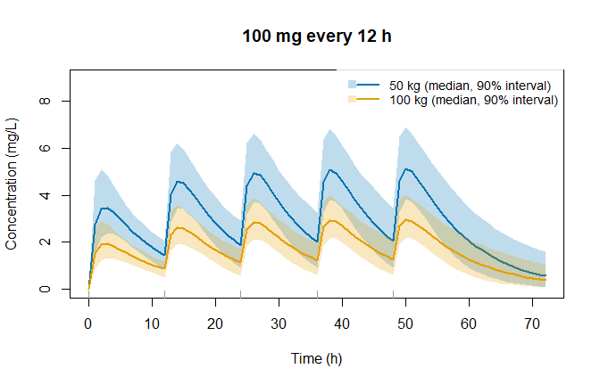

# Covariates and informative priors

``` r

library(bayespk)
```

## Covariates

Covariate effects are formulas on the parameters:

- `(WT / 70)^0.75` fixes the exponent.
- `(WT / 70)^b_wt` estimates the exponent as a parameter named `b_wt`.
- `exp(b_age * (AGE - 40))` and `(SEX == 1)^b_sex` are also available.

Terms can be multiplied, as in
`CL ~ (WT / 70)^0.75 * (CRCL / 100)^b_crcl`. Covariates must be constant
within a subject.

``` r

mod_wt <- pk_model("1cmt", route = "oral", iiv = c("CL", "V", "KA"),
                   covariates = list(CL ~ (WT / 70)^0.75, V ~ (WT / 70)^b_wt))
fit_wt <- bpk_fit(mod_wt, bpk_example, chains = 4, cores = 4, seed = 1)
summary(fit_wt)
#>    variable   mean     sd     q5    q50    q95 rhat ess_bulk ess_tail
#>          CL  2.900 0.1170  2.710  2.900  3.100 1.00     6540     3060
#>           V 28.200 1.4700 25.800 28.100 30.700 1.00     3950     2710
#>          KA  0.983 0.0915  0.843  0.978  1.140 1.00     3850     2670
#>        b_wt  0.856 0.2610  0.431  0.857  1.270 1.00     1160     1810
#>    omega_CL  0.202 0.0308  0.156  0.199  0.257 1.00     1050     2070
#>     omega_V  0.241 0.0430  0.177  0.238  0.316 1.00     1350     2250
#>    omega_KA  0.375 0.0826  0.255  0.367  0.525 1.01     1680     2660
#>  sigma_prop  0.156 0.0114  0.138  0.155  0.175 1.00     2020     3090
```

`bpk_example` was simulated with a weight exponent of 1 on V and 0.75 on
CL, which is fixed here.

To predict for a particular subject, pass covariate values. Here, a 50
kg and a 100 kg subject on the same regimen:

``` r

reg <- dose_regimen(100, ii = 12, n = 5)
light <- predict(fit_wt, regimen = reg, covariates = list(WT = 50), times = seq(0, 72, 1))
heavy <- predict(fit_wt, regimen = reg, covariates = list(WT = 100), times = seq(0, 72, 1))
plot(light, compare = heavy, labels = c("50 kg", "100 kg"), main = "100 mg every 12 h",
     xlab = "Time (h)", ylab = "Concentration (mg/L)")
```



plot of chunk cov-pred

## Informative priors

A common reason for a Bayesian analysis is to use what is already known,
for example adult values when only a small paediatric study is
available. Priors are given with
[`pk_priors()`](https://daikikumakura.github.io/bayespk/reference/pk_priors.md):

- `lognormal(meanlog, sdlog)` for typical values (`CL`, `V`, `V1`, `Q`,
  `V2`, `KA`).
- `normal(mean, sd)` for covariate effects (`b_wt`, …).
- `half_normal(scale)` for between-subject SDs (`omega`, or `omega_CL`
  for one parameter) and residual SDs (`sigma_prop`, `sigma_add`,
  `sigma_log`).

Suppose an earlier study gave a CL of about 3 L/h with 20% uncertainty,
and a weight exponent on V near 1. Now only 8 subjects are available:

``` r

small <- bpk_example[bpk_example$ID %in% c(3, 6, 9, 12, 18, 21, 24, 27), ]
pri <- pk_priors(CL = lognormal(log(3), 0.2), b_wt = normal(1, 0.25))
fit_small_weak <- bpk_fit(mod_wt, small, chains = 4, cores = 4, seed = 1)
fit_small_inf <- bpk_fit(mod_wt, small, priors = pri, chains = 4, cores = 4, seed = 1)
fit_small_inf$priors
#>     quantity distribution location scale  source
#> 1         CL    lognormal 1.098612  0.20    user
#> 2          V    lognormal 3.566312  2.00 default
#> 3         KA    lognormal 0.000000  2.00 default
#> 4       b_wt       normal 1.000000  0.25    user
#> 5   omega_CL  half_normal 0.000000  1.00 default
#> 6    omega_V  half_normal 0.000000  1.00 default
#> 7   omega_KA  half_normal 0.000000  1.00 default
#> 8 sigma_prop  half_normal 0.000000  0.50 default
```

The table marks which priors came from the user and which are defaults.
Posterior 90% intervals with the default and the informative priors:

``` r

s1 <- summary(fit_small_weak)
s2 <- summary(fit_small_inf)
keep <- c("CL", "V", "b_wt")
data.frame(variable = keep,
           default_q5 = s1$q5[match(keep, s1$variable)],
           default_q95 = s1$q95[match(keep, s1$variable)],
           informative_q5 = s2$q5[match(keep, s2$variable)],
           informative_q95 = s2$q95[match(keep, s2$variable)])
#>   variable default_q5 default_q95 informative_q5 informative_q95
#> 1       CL   2.317795    3.417294      2.4659782        3.355258
#> 2        V  22.206631   35.309272     24.2506442       36.200781
#> 3     b_wt  -0.720297    1.499585      0.5973676        1.378400
```

## Is the result driven by the prior?

[`prior_sensitivity()`](https://daikikumakura.github.io/bayespk/reference/prior_sensitivity.md)
scales the prior and the likelihood up and down (power-scaling, with the
priorsense package) and reports which parameters respond. The flags
“prior-data conflict” and “strong prior / weak likelihood” mean that the
conclusion depends on the prior. In that case, report the prior and
justify it.

``` r

prior_sensitivity(fit_small_inf)
#> Sensitivity based on cjs_dist
#> Prior selection: all priors
#> Likelihood selection: all data
#> 
#>    variable prior likelihood                                diagnosis
#>          CL 0.027      0.019                                        -
#>           V 0.006      0.049                                        -
#>          KA 0.004      0.062                                        -
#>        b_wt 0.086      0.026 potential strong prior / weak likelihood
#>    omega_CL 0.031      0.055                                        -
#>     omega_V 0.019      0.027                                        -
#>    omega_KA 0.012      0.076                                        -
#>  sigma_prop 0.004      0.382                                        -
```
