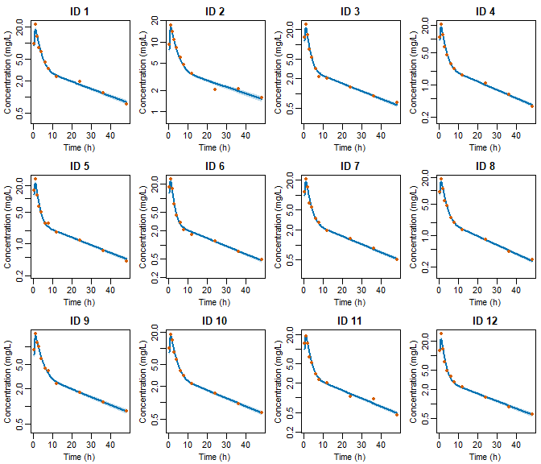
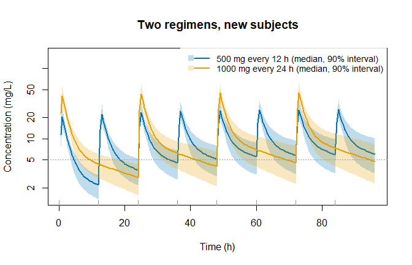

# Two-compartment models and regimen comparison

``` r

library(bayespk)
```

## Simulate an infusion study

[`pk_conc()`](https://daikikumakura.github.io/bayespk/reference/pk_conc.md)
uses the same closed-form solutions as the model, so it can simulate
data. Here, 20 subjects receive a 1-hour infusion of 500 mg
(`RATE = 500`) and are sampled up to 48 hours:

``` r

set.seed(1)
truth <- c(CL = 4, V1 = 20, Q = 6, V2 = 60)
times <- c(0.5, 1, 2, 3, 4, 6, 8, 12, 24, 36, 48)
d <- do.call(rbind, lapply(1:20, function(i) {
  par <- truth * exp(c(rnorm(2, 0, c(0.3, 0.2)), 0, 0))
  conc <- pk_conc(times, dose_regimen(500, rate = 500), par, "2cmt", "iv")
  rbind(data.frame(ID = i, TIME = 0, AMT = 500, RATE = 500, DV = NA, EVID = 1),
        data.frame(ID = i, TIME = times, AMT = 0, RATE = 0,
                   DV = conc * (1 + rnorm(length(times), 0, 0.1)), EVID = 0))
}))
head(d)
#>   ID TIME AMT RATE        DV EVID
#> 1  1  0.0 500  500        NA    1
#> 2  1  0.5   0    0  9.902533    0
#> 3  1  1.0   0    0 22.618118    0
#> 4  1  2.0   0    0 13.303036    0
#> 5  1  3.0   0    0  8.163058    0
#> 6  1  4.0   0    0  6.797243    0
```

## Fit

``` r

mod2 <- pk_model("2cmt", route = "iv", iiv = c("CL", "V1"), error = "proportional")
fit2 <- bpk_fit(mod2, d, chains = 4, cores = 4, seed = 1)
summary(fit2)
#>    variable    mean      sd      q5     q50    q95 rhat ess_bulk ess_tail
#>          CL  3.9100 0.20600  3.5800  3.9100  4.260 1.00     7550     3160
#>          V1 19.2000 1.19000 17.3000 19.2000 21.300 1.00     6300     3060
#>           Q  5.8200 0.12400  5.6100  5.8200  6.020 1.00     7040     3010
#>          V2 57.9000 1.17000 56.1000 57.9000 59.900 1.00     6840     2990
#>    omega_CL  0.2340 0.04240  0.1780  0.2280  0.314 1.01      573      962
#>    omega_V1  0.2620 0.05060  0.1920  0.2560  0.352 1.00      813     1590
#>  sigma_prop  0.0966 0.00513  0.0886  0.0964  0.105 1.00     4250     3010
```

The simulated values were CL 4, V1 20, Q 6 and V2 60, with
between-subject SDs of 0.3 and 0.2 and a residual SD of 0.1. The fit
took 46 seconds.

``` r

plot(fit2, log = TRUE, xlab = "Time (h)", ylab = "Concentration (mg/L)")
```



plot of chunk ind2

## Compare regimens

Posterior predictions answer questions such as “which regimen keeps more
new patients above 5 mg/L at the end of the dosing interval?”
[`predict()`](https://rdrr.io/r/stats/predict.html) returns quantiles.
For other summaries, use the draws
([`bpk_draws()`](https://daikikumakura.github.io/bayespk/reference/bpk_draws.md))
with
[`pk_conc()`](https://daikikumakura.github.io/bayespk/reference/pk_conc.md).

``` r

t <- seq(0, 96, 0.5)
a <- predict(fit2, regimen = dose_regimen(500, ii = 12, n = 8, rate = 500), times = t)
b <- predict(fit2, regimen = dose_regimen(1000, ii = 24, n = 4, rate = 1000), times = t)
plot(a, compare = b, log = TRUE, labels = c("500 mg every 12 h", "1000 mg every 24 h"),
     main = "Two regimens, new subjects", xlab = "Time (h)", ylab = "Concentration (mg/L)")
abline(h = 5, col = "#999999", lty = 3)
```



plot of chunk regimens

Concentrations at 96 hours, the end of the last interval of both
regimens (5%, 50% and 95% of new subjects):

``` r

rbind(q12h = unlist(a[a$TIME == 96, c("q5", "q50", "q95")]),
      q24h = unlist(b[b$TIME == 96, c("q5", "q50", "q95")]))
#>            q5      q50       q95
#> q12h 3.213149 6.035814 10.181762
#> q24h 2.320907 4.748404  8.519728
```

## Oral two-compartment models and flip-flop

With oral dosing, the absorption rate KA and the fast disposition rate
can swap: two parameter sets then fit the data equally well. If that
happens,
[`bpk_fit()`](https://daikikumakura.github.io/bayespk/reference/bpk_fit.md)
warns that the chains settled in different regions and shows the chain
medians. When absorption is known to be faster than distribution,
`ka_faster = TRUE` constrains the typical KA above the disposition rate
and removes the second mode:

``` r

pk_model("2cmt", route = "oral", iiv = c("CL", "V1", "KA"), ka_faster = TRUE)
```

Do not use it for drugs whose absorption is slower than distribution
(flip-flop kinetics, for example many extended-release forms).
