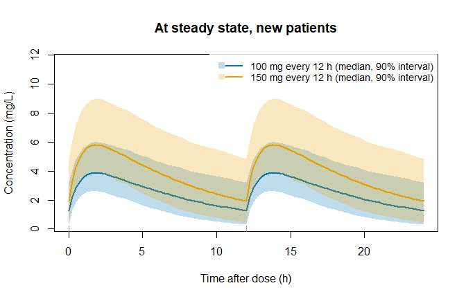

<!-- Precomputed: this file is generated from vignettes/src/data-features.Rmd.orig. -->


``` r
library(bayespk)
```

Clinical PK data often come from patients already on treatment (steady state) and contain concentrations below the lower limit of quantification (LLOQ). bayespk reads both from NONMEM-style columns.

## Steady state (`SS = 1`)

A dose record with `SS = 1` and `II` means that the dose has been given every `II` for a long time. Concentrations are computed in closed form as the sum over the infinite train of earlier doses. Earlier dose records of the subject are ignored, as in NONMEM. Observations within one interval before the steady-state dose, typically the pre-dose trough, are used.

Simulated example: 16 patients on 100 mg every 12 hours, sampled from a trough just before the observed dose to the next trough.


``` r
set.seed(2)
times <- c(-0.25, 1, 2, 4, 8, 11.5)
ss_data <- do.call(rbind, lapply(1:16, function(i) {
  par <- c(CL = 3 * exp(rnorm(1, 0, 0.3)), V = 30 * exp(rnorm(1, 0, 0.2)), KA = 1.2)
  conc <- pk_conc(times, dose_regimen(100, ii = 12, ss = TRUE), par, "1cmt", "oral")
  rbind(data.frame(ID = i, TIME = 0, AMT = 100, II = 12, SS = 1, DV = NA, EVID = 1),
        data.frame(ID = i, TIME = times, AMT = 0, II = 0, SS = 0,
                   DV = signif(conc * (1 + rnorm(length(times), 0, 0.15)), 3), EVID = 0))
}))
head(ss_data, 7)
#>   ID  TIME AMT II SS   DV EVID
#> 1  1  0.00 100 12  1   NA    1
#> 2  1 -0.25   0  0  0 3.04    0
#> 3  1  1.00   0  0  0 3.64    0
#> 4  1  2.00   0  0  0 4.67    0
#> 5  1  4.00   0  0  0 4.40    0
#> 6  1  8.00   0  0  0 3.58    0
#> 7  1 11.50   0  0  0 2.41    0
```


``` r
fit_ss <- bpk_fit(pk_model("1cmt", "oral", iiv = c("CL", "V")), ss_data,
                  chains = 4, cores = 4, seed = 1)
summary(fit_ss)
#>    variable   mean     sd     q5    q50    q95 rhat ess_bulk ess_tail
#>          CL  3.330 0.2790  2.890  3.320  3.800    1     4620     2770
#>           V 27.700 2.8500 23.400 27.500 32.700    1     3650     2770
#>          KA  1.230 0.2440  0.920  1.200  1.660    1     3650     2690
#>    omega_CL  0.321 0.0686  0.230  0.311  0.445    1      683     1480
#>     omega_V  0.280 0.0855  0.158  0.270  0.431    1     1590     1900
#>  sigma_prop  0.171 0.0156  0.148  0.170  0.199    1     2340     2420
```

The data were simulated with CL 3, V 30 and KA 1.2. Steady-state data carry little information about absorption: only one sampled interval and no single-dose profile. The interval for KA is therefore wider than for CL.

Predictions at steady state use `dose_regimen(ss = TRUE)`, here 100 mg against 150 mg every 12 hours:


``` r
a <- predict(fit_ss, regimen = dose_regimen(100, ii = 12, n = 2, ss = TRUE), times = seq(0, 24, 0.25))
b <- predict(fit_ss, regimen = dose_regimen(150, ii = 12, n = 2, ss = TRUE), times = seq(0, 24, 0.25))
plot(a, compare = b, labels = c("100 mg every 12 h", "150 mg every 12 h"),
     main = "At steady state, new patients", xlab = "Time after dose (h)", ylab = "Concentration (mg/L)")
```

<div class="figure">

<p class="caption">plot of chunk ss-pred</p>
</div>

## Below the quantification limit (`CENS = 1`)

Put the LLOQ in `DV` and `CENS = 1` on such rows. The likelihood of these observations is the probability that the concentration is below the limit (Beal's M3 method), instead of a density at an invented value. Dropping them, or setting them to LLOQ/2, biases late-phase and elimination estimates.


``` r
set.seed(4)
times <- c(0.5, 1, 2, 4, 6, 8, 12, 24, 36)
lloq <- 0.5
blq_data <- do.call(rbind, lapply(1:20, function(i) {
  par <- c(CL = 3 * exp(rnorm(1, 0, 0.3)), V = 30, KA = 1.2)
  conc <- pk_conc(times, dose_regimen(100), par, "1cmt", "oral")
  dv <- conc * (1 + rnorm(length(times), 0, 0.15))
  cens <- as.numeric(dv < lloq)
  rbind(data.frame(ID = i, TIME = 0, AMT = 100, DV = NA, EVID = 1, CENS = 0),
        data.frame(ID = i, TIME = times, AMT = 0, DV = ifelse(cens == 1, lloq, dv), EVID = 0, CENS = cens))
}))
table(blq_data$CENS[blq_data$EVID == 0])
#> 
#>   0   1 
#> 143  37
fit_blq <- bpk_fit(pk_model("1cmt", "oral", iiv = "CL"), blq_data, chains = 4, cores = 4, seed = 1)
#> 37 observation(s) below the quantification limit (CENS = 1) are handled by Beal's M3 method.
summary(fit_blq)
#>    variable   mean      sd     q5    q50    q95 rhat ess_bulk ess_tail
#>          CL  3.330 0.24100  2.950  3.320  3.730    1     4350     2830
#>           V 29.700 0.79500 28.500 29.700 31.000    1     2600     2910
#>          KA  1.180 0.06270  1.080  1.180  1.290    1     2650     2950
#>    omega_CL  0.309 0.05580  0.231  0.303  0.414    1      624     1060
#>  sigma_prop  0.141 0.00917  0.127  0.141  0.157    1     3040     2840
```

The data were simulated with CL 3, V 30, KA 1.2, a between-subject SD of 0.3 on CL and a proportional residual SD of 0.15.

`CENS = 1` works with every residual error model; with `error = "log"` the limit must be positive.
